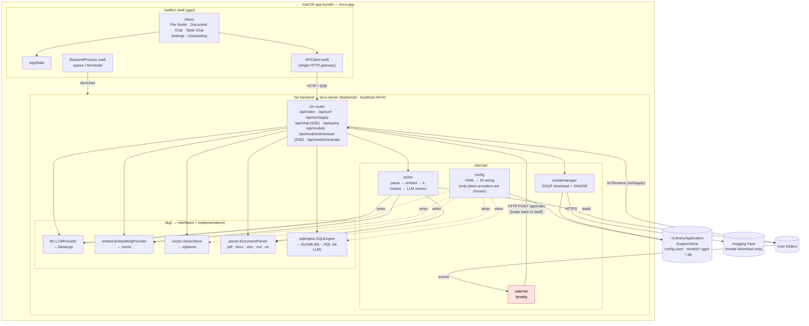
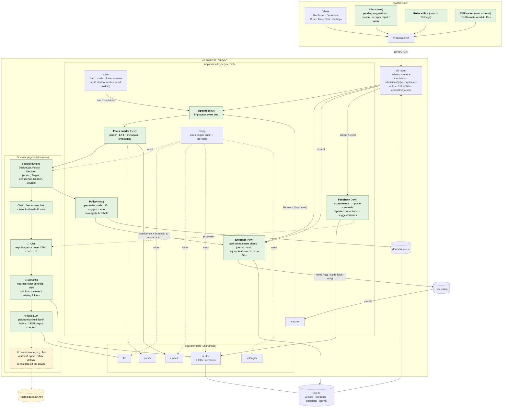

# Arca Architecture

_Last updated: 2026-10-12_

Arca is a local-first macOS file assistant. A SwiftUI shell launches an embedded
Go backend that does all parsing, embedding, retrieval, and inference on-device.

This document has two diagrams:

1. **Current state:** what is in `main` today.
2. **Target state:** the direction agreed in ADR-0006 to ADR-0008 (decision engine,
   learning from existing folders, optional hosted decision models).

The reasoning behind each choice is in [`docs/adr/`](../adr/README.md).

---

## 1. Current state (2026-10-12)

### Known gaps in the current state

| Area | Gap | Addressed by |
|---|---|---|
| `/api/sort/apply` | Joins user-supplied paths without checking they stay inside `folder`, so `../` escapes are possible | ADR-0006 (Executor owns all file moves) |
| Watcher | Sends files to indexing by calling its own HTTP API with hand-built JSON (breaks on quotes in paths). Only indexes, never decides | ADR-0006 (in-process event pipeline) |
| Sorting | One-shot batch suggestions. Ignores the user's existing folder structure and doesn't learn from corrections | ADR-0006, ADR-0007 |
| Server lifecycle | No graceful `http.Server.Shutdown`. No `/health` or `/ready` | Not yet decided |
| API conventions | Routes aren't versioned (`/api/*`). The `error` field is `""` instead of `null` | Not yet decided |
| Repo hygiene | ~74 MB binaries and `dist/Arca.app` are committed | Not yet decided |

---

## 2. Target state: decision engine

### How a file flows through the target design

1. **Event:** the watcher, a manual sort, or an API call puts a file on the in-process pipeline.
2. **Facts:** the parser and EXIF/metadata fallback produce a snippet, which is then embedded.
3. **Decide:** the chain tries user rules first, then the nearest existing folder, then the
   local LLM. A hosted model is used only if the user turned it on. Every `Decision` has a
   `Reason` and a `Source`.
4. **Policy:** decides whether to apply automatically or queue a suggestion. The default is
   `suggest`. A folder becomes eligible for `auto` once its acceptance rate is high enough.
5. **Execute:** the Executor checks the target stays inside the folder, records the action in
   the journal (for undo), and moves the file.
6. **Learn:** accepting or rejecting a suggestion updates the folder centroids. Repeated
   identical corrections become suggested rules.

### Phasing

| Phase | Deliverable | ADR |
|---|---|---|
| 1 | `pkg/decision` types, Executor + journal + undo; route `/api/sort/apply` through the Executor | 0006 |
| 2 | Rules engine (`expr-lang/expr`) + `/api/v1/rules` + Rules editor | 0006 |
| 3 | Semantic engine built from existing folders, local LLM fallback, in-process watcher pipeline, Inbox | 0006, 0007 |
| 4 | Feedback loop, optional calibration, per-folder auto mode | 0007 |
| later | Optional hosted decision provider (e.g. Jev), off by default | 0008 |
